# Gecko Care

<p align="center">
  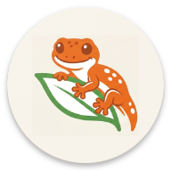
</p>

<p align="center">
  <strong>The complete care diary for your leopard gecko</strong><br/>
  Feeding, growth, shedding, environment, expenses and reminders — all offline, on your device.
</p>

<p align="center">
  
  
  
  
  
</p>

---

## Why Gecko Care

Generic pet-care apps don't think about what a leopard gecko actually needs: meals made of several feeder species at once, calcium/D3 supplementation tracked per meal, hot spot and cold spot temperatures, shed cycles, feeding plans that change with age. Gecko Care exists for exactly that: a personal management tool, not veterinary software, built for anyone keeping one or more leopard geckos who wants everything — data, history, costs — in one place, with no account and no cloud.

---

## Features

### 🦎 Animal management
- Multi-animal: a profile for each gecko (name, morph, sex, hatch date and/or "gotcha day")
- Profile photo and identifying color with a full HSV color picker
- **Photo gallery / growth diary**: add unlimited timestamped photos per animal, browse them in a strip, view full-screen, delete anytime — separate from the single profile photo
- Free-form tags to organize your collection and filter the list
- Unique QR code per animal, tap to enlarge: encodes a readable card (name, morph, age, weight, feeding plan) that any QR scanner can read, even without the app installed
- In-app scanner: jumps straight to a profile if the animal exists on that device, otherwise shows the readable card in a dialog (handy for a vet/pet-sitter scanning your gecko's enclosure label with their own phone)

### 🍽️ Feeding
- Feeding log with **mixed meals**: several feeder species in the same meal event (e.g. mealworms + dubia)
- Outcome (accepted/refused) and supplement tracking (calcium, D3, multivitamin) per meal
- Automatic age-based feeding plan, with customizable stages (frequency, supplement notes) and per-animal overrides
- Edit and delete any logged meal

### 📈 Growth & shedding
- Weight and length logging with trend indicators
- Shed log (complete/partial) with an automatic estimate of the next shed based on historical average interval
- History browsable and editable for both

### 🌡️ Environment
- Manual logging of hot spot, cold spot, humidity and night temperature (measured with the enclosure's thermometer/hygrometer)
- Reading history

### 📝 Notes & reminders
- Free-text behavior and health notes
- Custom reminders (feeding, weight, enclosure cleaning, supplements) with scheduled notifications and configurable frequency

### 💰 Expenses
- Expenses by category (feeders, supplements, substrate/enclosure, vet, other)
- View by single animal or whole collection, with an expandable monthly breakdown
- Edit and delete any expense
- Automatic currency (from the device) or fixed to EUR / USD / GBP / CHF

### 📊 Statistics & export
- Weight-over-time chart and meals-per-week chart
- Summary (average shed interval, growth last month, meal refusal rate)
- CSV export for a single animal or the whole collection

### 🎨 Design & localization
- Warm palette inspired by the leopard gecko and its desert habitat (terracotta, sand, gold), with light and dark theme
- Italian and English, automatic from system language or manual override in Settings
- Light, fast navigation animations

### 💾 Backup & restore
- Manual "Back up now" or automatic backup on a daily/weekly schedule, to a folder you choose (no account, no cloud — just a `.zip` on your device or an SD card/cloud-synced folder)
- Each backup bundles the full database, settings and all gallery photos
- Restore from any previous backup file; the app reapplies it and restarts automatically

---

## Requirements

- Android 8.0 (API 26) or higher

---

## Permissions

| Permission | Why it is needed |
|-----------|-----------------|
| `POST_NOTIFICATIONS` | Reminder notifications (feeding, weight, cleaning, supplements) |
| `CAMERA` | Scan a QR code to quickly open an animal's profile |

No network, contacts, or location permissions: all data stays on the device. Backup/restore uses the Storage Access Framework folder/file pickers, so it needs no storage permission either.

---

## Screenshots

<p align="center">
  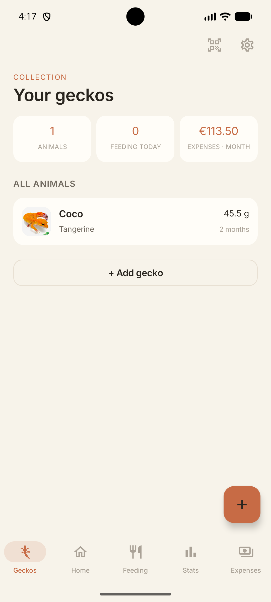
  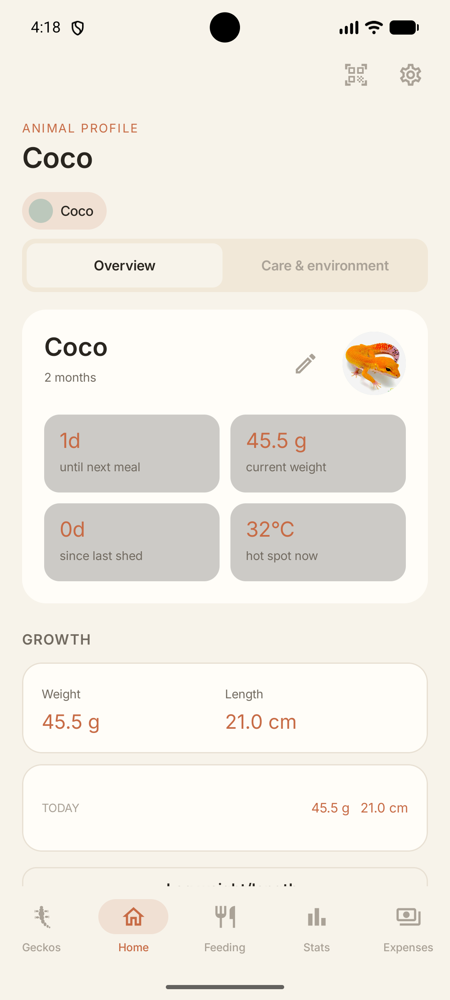
  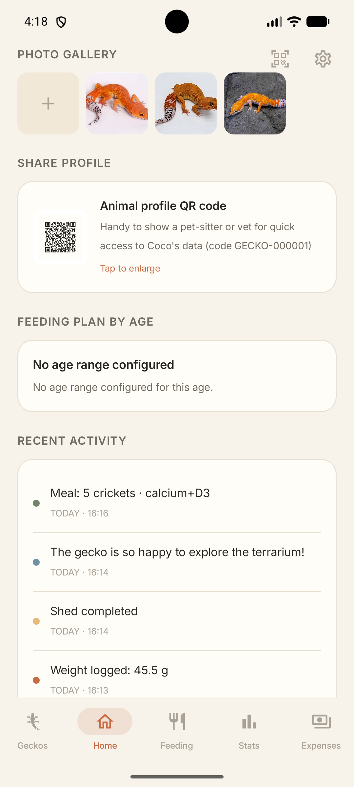
  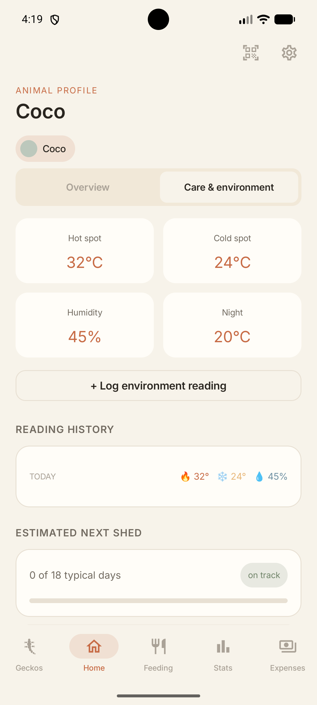
  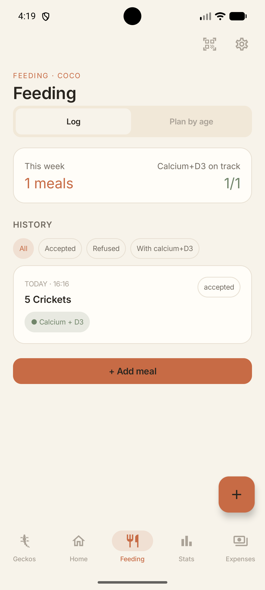
</p>

<p align="center">
  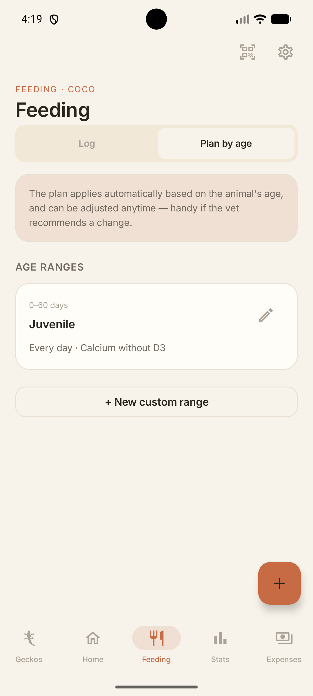
  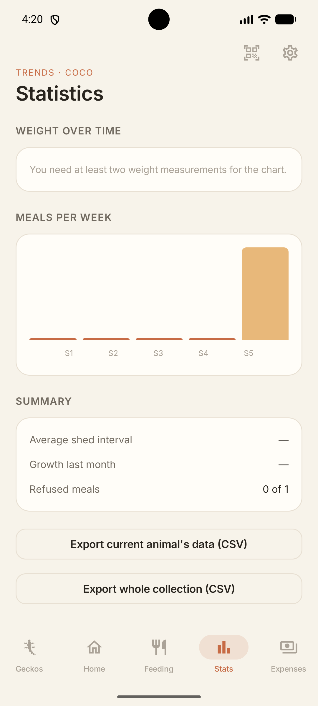
  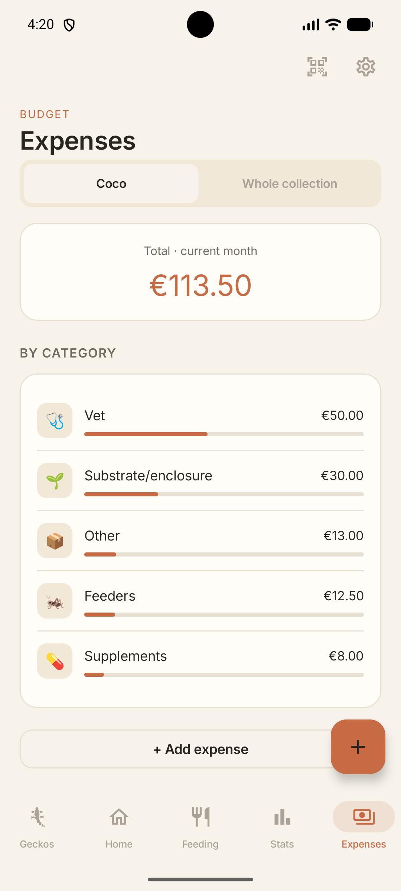
  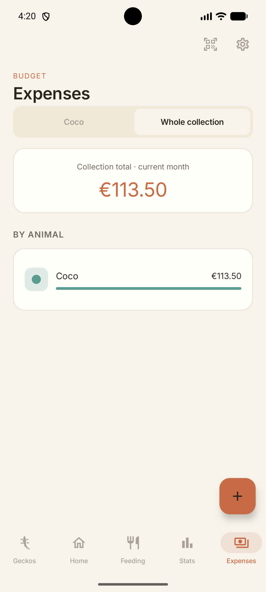
  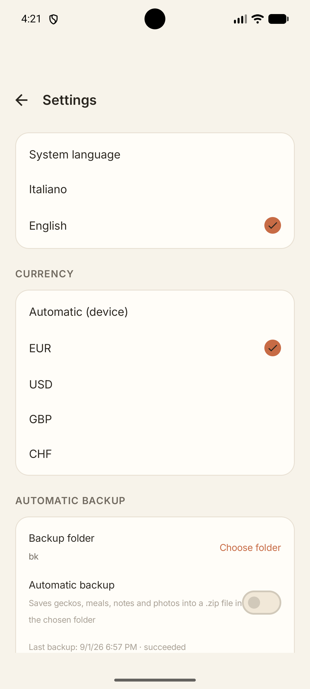
</p>

---

## Building from source

```bash
git clone https://github.com/amletoflorio/Gecko-Care.git
cd Gecko-Care
./gradlew assembleDebug
```

**Requirements:** Android Studio · JDK 17 · Min SDK 26 · Target SDK 34 · Compile SDK 34

---

## Tech stack

| Layer | Technology |
|-------|-----------|
| UI | Jetpack Compose, Material 3, Navigation Compose |
| Architecture | MVVM, StateFlow, Coroutines |
| Database | Room (SQLite) |
| Preferences | DataStore Preferences |
| Per-app language | AppCompat (`AppCompatDelegate.setApplicationLocales`) |
| QR code | ZXing core + zxing-android-embedded (generation and scanning) |
| Reminder notifications | WorkManager + `NotificationCompat` |
| Currency formatting | `java.text.NumberFormat` / `java.util.Currency` |

---

## Project structure

```
app/src/main/
├── java/com/terra/geckocare/
│   ├── data/
│   │   ├── backup/          Backup .zip creation and restore staging (SAF)
│   │   ├── local/          Room entities, DAOs, database, migrations
│   │   ├── photo/          Animal profile photo management
│   │   ├── repository/     Repositories for geckos, meals, expenses, growth, shed, environment, reminders, photos
│   │   └── settings/       Theme, language, currency, backup settings (DataStore)
│   ├── di/                 AppContainer and manual ViewModel factory (no Hilt)
│   ├── domain/              Domain logic: feeding plan, shed interval, CSV export, formatting
│   ├── ui/
│   │   ├── common/          Reusable components (card, chip, buttons, color picker, QR)
│   │   ├── gechi/            Animal list, add/edit gecko
│   │   ├── home/              Animal profile: overview, care & environment, notes, reminders, growth, shed
│   │   ├── navigation/        Routes, bottom-nav icons and shared selected-animal state
│   │   ├── pasti/              Feeding log, plan by age
│   │   ├── settings/            Settings (theme, language, currency, backup & restore)
│   │   ├── spese/                Budget and expenses
│   │   ├── stats/                  Statistics and export
│   │   └── theme/                  Color palette, typography, light/dark theme
│   └── worker/               Scheduled reminder notifications, automatic backup worker
└── res/
    ├── values/                Italian strings (default), colors, themes
    ├── values-en/              English strings
    └── font/                    Inter font
```

---

## License

MIT — see [LICENSE](LICENSE) for details.

---

## Credits

App developed by **Amlet**
